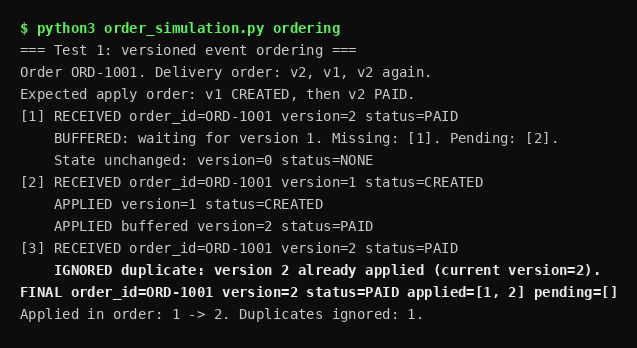
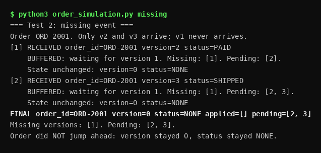
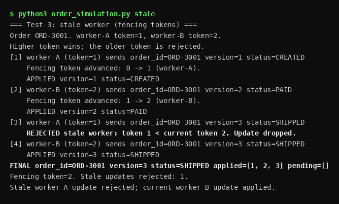

# Order Event Ordering Simulation

A small Python simulation of how a distributed system handles event
ordering, delayed messages, and stale workers. An order moves through
versioned states: v1 CREATED, v2 PAID, v3 SHIPPED. Events may arrive
late, out of order, or more than once. Ordering is decided by version,
never by arrival time.

One file, standard library only, no helper files:

- `order_simulation.py` — the whole simulation
- `evidence/` — full terminal output captured from real runs
- `screenshots/` — PNG screenshots of the same runs

## How it works

Every event carries `order_id`, `version`, and `status`.

- **Next version only.** An event is applied only when its version is
  exactly the next expected version for that order.
- **Buffering.** A future version is held in a pending buffer. When the
  missing version arrives, buffered versions drain in order.
- **Duplicates.** A version at or below the applied version, or already
  in the buffer, is ignored and counted.
- **Missing versions.** The gap between the expected version and the
  highest buffered version is reported as missing; the order never
  jumps ahead to a later status.
- **Fencing tokens.** Each worker has an increasing token. The store
  remembers the highest token seen per order and rejects any update
  from a worker with an older token before checking its version.

## Running

Requires Python 3.10+. No packages to install.

```bash
python3 order_simulation.py ordering   # v2, v1, v2 again
python3 order_simulation.py missing    # only later versions arrive
python3 order_simulation.py stale      # two workers, fencing tokens
python3 order_simulation.py            # all three, in order
```

Evidence below was run with Python 3.12. Output is deterministic: no
timestamps, no randomness, so re-running gives the same result.

## Example: correct event ordering

`python3 order_simulation.py ordering`. Full log:
`evidence/01-ordering.log`.

```
=== Test 1: versioned event ordering ===
Order ORD-1001. Delivery order: v2, v1, v2 again.
Expected apply order: v1 CREATED, then v2 PAID.
[1] RECEIVED order_id=ORD-1001 version=2 status=PAID
    BUFFERED: waiting for version 1. Missing: [1]. Pending: [2].
    State unchanged: version=0 status=NONE
[2] RECEIVED order_id=ORD-1001 version=1 status=CREATED
    APPLIED version=1 status=CREATED
    APPLIED buffered version=2 status=PAID
[3] RECEIVED order_id=ORD-1001 version=2 status=PAID
    IGNORED duplicate: version 2 already applied (current version=2).
FINAL order_id=ORD-1001 version=2 status=PAID applied=[1, 2] pending=[]
Applied in order: 1 -> 2. Duplicates ignored: 1.
```

Version 2 arrived first and waited. Version 1 was applied, then the
buffered version 2 drained. Applied order is 1, then 2.



## Evidence: duplicate handling

Same run, delivery [3] above: version 2 arrives a second time after it
is already applied. The program logs `IGNORED duplicate` and the final
state is unchanged: `version=2`, `applied=[1, 2]`, one duplicate
ignored. The duplicate is never applied twice.

## Evidence: missing event

`python3 order_simulation.py missing`. Full log:
`evidence/02-missing-event.log`.

```
=== Test 2: missing event ===
Order ORD-2001. Only v2 and v3 arrive; v1 never arrives.
[1] RECEIVED order_id=ORD-2001 version=2 status=PAID
    BUFFERED: waiting for version 1. Missing: [1]. Pending: [2].
    State unchanged: version=0 status=NONE
[2] RECEIVED order_id=ORD-2001 version=3 status=SHIPPED
    BUFFERED: waiting for version 1. Missing: [1]. Pending: [2, 3].
    State unchanged: version=0 status=NONE
FINAL order_id=ORD-2001 version=0 status=NONE applied=[] pending=[2, 3]
Missing versions: [1]. Pending: [2, 3].
Order did NOT jump ahead: version stayed 0, status stayed NONE.
```

Neither later version was applied. Version 1 is recorded as missing,
versions 2 and 3 stay pending, and the order stays at version 0.



## Evidence: stale-worker rejection

`python3 order_simulation.py stale`. Full log:
`evidence/03-stale-worker.log`.

```
=== Test 3: stale worker (fencing tokens) ===
Order ORD-3001. worker-A token=1, worker-B token=2.
Higher token wins; the older token is rejected.
[1] worker-A (token=1) sends order_id=ORD-3001 version=1 status=CREATED
    Fencing token advanced: 0 -> 1 (worker-A).
    APPLIED version=1 status=CREATED
[2] worker-B (token=2) sends order_id=ORD-3001 version=2 status=PAID
    Fencing token advanced: 1 -> 2 (worker-B).
    APPLIED version=2 status=PAID
[3] worker-A (token=1) sends order_id=ORD-3001 version=3 status=SHIPPED
    REJECTED stale worker: token 1 < current token 2. Update dropped.
[4] worker-B (token=2) sends order_id=ORD-3001 version=3 status=SHIPPED
    APPLIED version=3 status=SHIPPED
FINAL order_id=ORD-3001 version=3 status=SHIPPED applied=[1, 2, 3] pending=[]
Fencing token=2. Stale updates rejected: 1.
Stale worker-A update rejected; current worker-B update applied.
```

The worker with the newer token (worker-B, token 2) updates the order.
The stale worker-A update with the older token (1) is rejected and
dropped before any version check.



## Reflection: why timestamps alone are not enough

Timestamps alone cannot guarantee correct ordering because clocks on
different machines drift and are never perfectly synchronized, so two
events can carry timestamps that disagree with the order they actually
happened. A timestamp also says nothing about whether an earlier event
is still in flight: a later timestamp arriving first looks complete
even when a version is missing. Retries and redelivery can reuse or
reorder timestamps, and two different events can share the same
timestamp, leaving no way to tell which came first. Version numbers
and fencing tokens fix this by giving every update an explicit,
gap-detectable place in a single sequence that does not depend on any
machine's clock.
